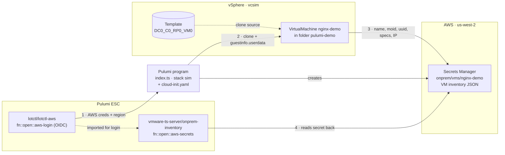

# vmware-ts-server

Pulumi TypeScript program that clones a Linux VM from an existing vSphere
template, installs nginx with a custom page via cloud-init (delivered through
VMware `guestinfo`), and outputs the VM IP and URL.

Two stacks select the target:

| Stack | Target | What it proves |
|-------|--------|----------------|
| `sim` | `vcsim` vCenter simulator in Docker | vSphere API calls succeed. No VM boots. |
| `lab` | Real vCenter/ESXi | End to end: nginx serves the page. |

All environment-specific values live in stack config; nothing is hardcoded in
`index.ts`. Provider settings are under the `vsphere:` namespace, the rest under
`vmware-ts-server:`.

## Architecture



1. ESC provides AWS credentials (OIDC) and the region to the stack.
2. Pulumi clones the VM in vSphere, configured by cloud-init through `guestinfo`.
3. The VM's outputs become the inventory record in AWS Secrets Manager.
4. A second ESC environment reads the secret back so it can be browsed in ESC.

## Config reference

| Key | Required | Description |
|-----|----------|-------------|
| `datacenter` | yes | Datacenter name |
| `cluster` | yes | Compute cluster, used when `resourcePool` is unset |
| `resourcePool` | no | Resource pool name (overrides `cluster`), e.g. `Compute-ResourcePool` |
| `folder` | no | Existing VM folder, e.g. `Workloads`. If unset, `pulumi-demo` is created |
| `datastore` | yes | Datastore name |
| `network` | yes | Port group name |
| `template` | yes | VM template name (may be a folder path) |
| `vmName` | yes | Name of the new VM |
| `cpus`, `memoryMb` | yes | VM sizing |
| `simulate` | no | `true` disables waiting for guest networking (vcsim) |
| `sshPublicKey` | no | Public key installed for user `ubuntu` |

## Sim mode (vcsim)

Requires Docker and `npm install`.

```bash
docker compose up -d vcsim
pulumi stack select sim
pulumi up
# inspect the inventory
docker compose run --rm govc find / -type m -name nginx-demo
pulumi destroy
docker compose down
```

Nothing boots in the simulator, so `ipAddress` is empty and `url` shows
`n/a (simulated)`. The default vcsim inventory is datacenter `DC0`, cluster
`DC0_C0`, datastore `LocalDS_0`, network `VM Network` and template VM
`DC0_C0_RP0_VM0`.

## ESC → vSphere → AWS demo

The program also writes an inventory record for the VM (name, moid, UUID,
placement, sizing, IP) to AWS Secrets Manager as `onprem/vms/<vmName>`.

1. **ESC → Pulumi:** the `sim` stack imports the ESC environment
   `lotctl/lotctl-aws`, which supplies short-lived AWS credentials via OIDC and
   `aws:region`.
2. **vSphere → AWS:** the secret's value is built from the VM's outputs, so
   Pulumi creates the VM first and the secret second.
3. **AWS → ESC:** the environment `vmware-ts-server/onprem-inventory` reads the
   secret back with ESC's `fn::open::aws-secrets` provider and parses it under
   `vms.nginx-demo`.

```bash
pulumi up -s sim
pulumi env open demo/vmware-ts-server/onprem-inventory vms
```

Or browse it in the console at
<https://app.pulumi.com/demo/esc/vmware-ts-server/onprem-inventory>. Opening
the environment fails until `pulumi up` has created the secret. The secret uses
`recoveryWindowInDays: 0`, so `pulumi destroy` deletes it immediately.

### ESC environments

Both environments live in the same Pulumi Cloud organization as the stack
(`demo`); ESC imports only resolve within one organization.

`lotctl/lotctl-aws` exchanges a Pulumi OIDC token for short-lived AWS
credentials and hands them to the stack. The IAM role must trust Pulumi Cloud's
OIDC provider (`api.pulumi.com/oidc`) for your organization.

```yaml
values:
  aws:
    creds:
      fn::open::aws-login:
        oidc:
          duration: 1h
          roleArn: arn:aws:iam::<account-id>:role/<oidc-role>
          sessionName: pulumi-environments-session
  # Exported to the Pulumi program and the AWS provider.
  environmentVariables:
    AWS_ACCESS_KEY_ID: ${aws.creds.accessKeyId}
    AWS_SECRET_ACCESS_KEY: ${aws.creds.secretAccessKey}
    AWS_SESSION_TOKEN: ${aws.creds.sessionToken}
  # Becomes stack config (aws:region) for every stack that imports this.
  pulumiConfig:
    aws:region: us-west-2
```

The stack links it in `Pulumi.sim.yaml`:

```yaml
environment:
  - lotctl/lotctl-aws
```

`vmware-ts-server/onprem-inventory` imports it for the AWS login, reads the
inventory secret with `fn::open::aws-secrets`, and parses the JSON so each field
is browsable:

```yaml
imports:
  - lotctl/lotctl-aws
values:
  inventory:
    fn::open::aws-secrets:
      region: us-west-2
      login: ${aws.creds}
      get:
        nginxDemo:
          secretId: onprem/vms/nginx-demo
  vms:
    nginx-demo:
      fn::fromJSON: ${inventory.nginxDemo}
```

Opened (`pulumi env open demo/vmware-ts-server/onprem-inventory vms`), it
returns:

```json
{
  "nginx-demo": {
    "name": "nginx-demo",
    "moid": "vm-76",
    "uuid": "a2db35b9-adaa-5414-b4ed-217774e96fd0",
    "datacenter": "DC0",
    "cluster": "DC0_C0",
    "datastore": "LocalDS_0",
    "network": "VM Network",
    "cpus": 1,
    "memoryMb": 1024,
    "ipAddress": null,
    "vcenter": "localhost:8989"
  }
}
```

## Lab mode (real vCenter)

### Prerequisites

1. Download the Ubuntu 24.04 cloud image OVA, `noble-server-cloudimg-amd64.ova`,
   from <https://cloud-images.ubuntu.com/noble/current/>.
2. In vCenter, deploy it with Deploy OVF Template, do not power it on, then
   Convert to Template.
3. If cloud-init uses the OVF datasource and ignores `guestinfo`, disable vApp
   Options on the template.
4. The port group needs DHCP and must be reachable from the machine running
   `curl`.

### Deploy

`Pulumi.lab.yaml` holds placeholders and comments. Create the stack and set
your values:

```bash
pulumi stack init lab
pulumi config set vsphere:vsphereServer vcenter.example.local
pulumi config set vsphere:user administrator@vsphere.local
pulumi config set --secret vsphere:password '<password>'
pulumi config set vsphere:allowUnverifiedSsl true
pulumi config set datacenter <dc>
pulumi config set cluster <cluster>
pulumi config set datastore <datastore>
pulumi config set network <port-group>
pulumi config set template ubuntu-2404-cloud
pulumi config set vmName nginx-demo
pulumi config set cpus 2
pulumi config set memoryMb 2048
pulumi config set simulate false
# optional
pulumi config set resourcePool <pool>
pulumi config set folder <folder>
pulumi config set sshPublicKey "$(cat ~/.ssh/id_ed25519.pub)"

pulumi up
curl "$(pulumi stack output url)"
```

VMC on AWS: set `folder` to `Workloads` and `resourcePool` to `Compute-ResourcePool`.

The inventory secret also needs AWS credentials and a region. Add an `environment:`
entry to `Pulumi.lab.yaml` (as in `Pulumi.sim.yaml`) or set them with
`pulumi config set aws:region <region>` and your usual AWS credentials.

## Troubleshooting

- Disk errors: `size` must be at least the template's, and `eagerlyScrub` and
  `thinProvisioned` must match it.
- SSL errors: `vsphere:allowUnverifiedSsl` must be `true` for self-signed certs.
- Keep provider config under `vsphere:` so the default provider picks it up.
